# HA-Games-Addon

**Spieleabend** – 18 Spiele für Home Assistant: Karten-, Zeichen-, Wort-, Quiz-, Party- und Trinkspiele.
Alle laufen im Browser, jeder spielt am eigenen Handy. Viele Spiele haben einen **📺 Fernseher-Modus**: Ein Gerät
(z. B. der Fernseher oder ein Tablet) wird zum großen Bildschirm für alle.

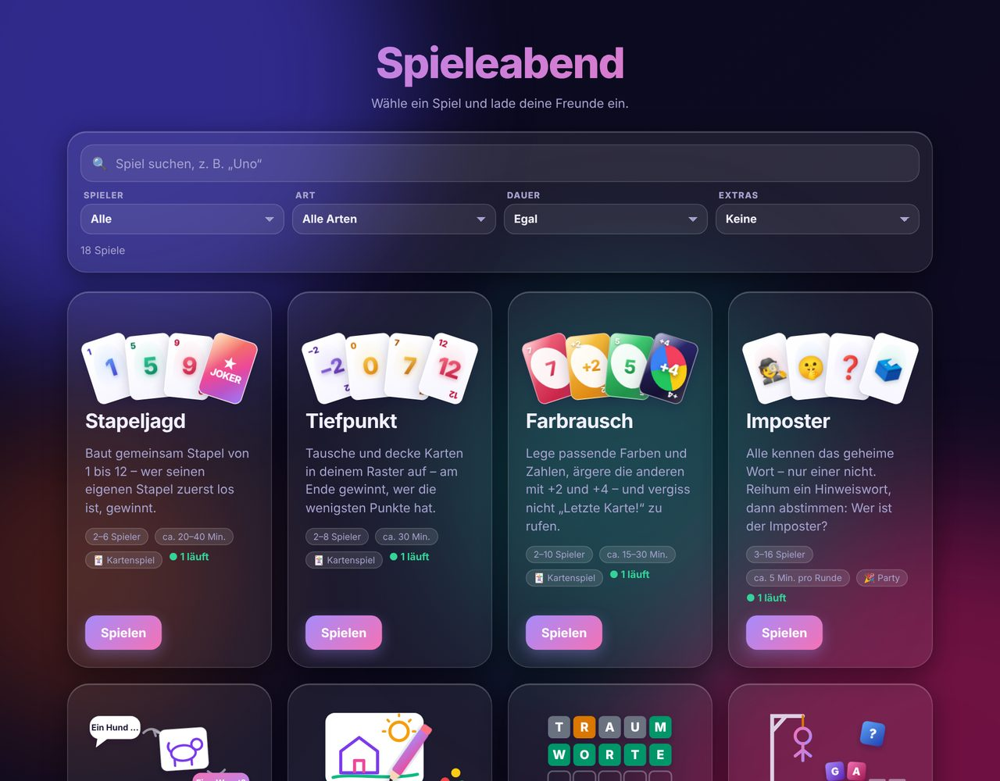

Auf der Startseite gibt es eine Suche und Filter für Spieleranzahl, Art, Dauer und Fernseher-Modus.

## Installation

Oder manuell: **Einstellungen → Add-ons → Add-on Store → ⋮ → Repositories** und
`https://github.com/fvh02/HA-Games-Addon` hinzufügen. Dann **Spieleabend** installieren.

## Die Spiele

Die Bilder stammen aus simulierten Runden (Alex, Lena, Jonas und Mia, dazu ein Fernseher).

### Kartenspiele

#### Stapeljagd
*2–6 Spieler · 20–40 Min.*

Baut gemeinsam Stapel von 1 bis 12 – wer seinen eigenen Stapel zuerst los ist, gewinnt. Joker passen überall.

#### Tiefpunkt
*2–8 Spieler · ca. 30 Min.*

Jeder hat ein Raster aus 12 verdeckten Karten. Aufdecken, tauschen, Spalten abräumen – am Ende gewinnt, wer die wenigsten Punkte hat.

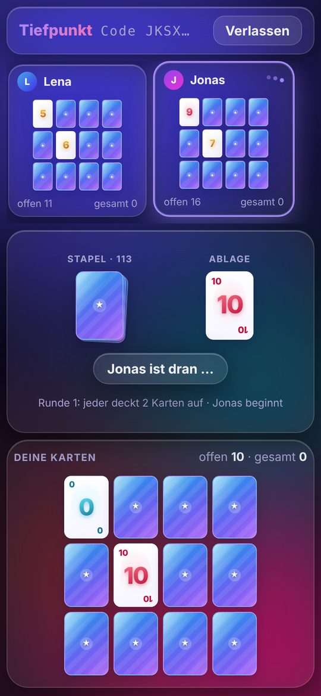

#### Farbrausch
*2–10 Spieler · 15–30 Min.*

Passende Farbe oder Zahl ablegen, die anderen mit +2 und +4 ärgern – und „Letzte Karte!“ nicht vergessen.

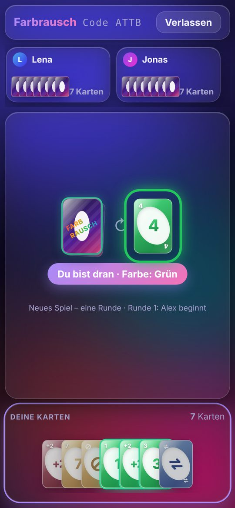

### Zeichnen

#### Kritzelpost
*3–10 Spieler · 10–20 Min.*

Stille Post mit Stift: Einer schreibt einen Satz, der Nächste zeichnet ihn, der Übernächste rät – am Ende wird das ganze Album gezeigt.

 

#### Schnellmaler
*2–12 Spieler · 15–25 Min. · 📺*

Einer zeichnet am Handy, alle anderen raten. Mit dem Fernseher als großem Bildschirm.

 

### Wörter

#### Wortgitter
*1 Spieler · 3–5 Min.*

Fünf Buchstaben, sechs Versuche – Wort des Tages oder endlos.

#### Galgenraten
*1–8 Spieler · 10–20 Min.*

Einer denkt sich ein Wort aus, alle anderen raten Buchstabe für Buchstabe, bevor der Galgen fertig ist.

### Quiz & Party

#### Schätzmeister
*2–16 Spieler · 10–20 Min. · 📺*

Wie tief ist der Marianengraben? Alle tippen eine Zahl – wer am nächsten dran ist, holt die Punkte. Mit Kategorien, z. B. Geschichte oder 🔩 Metallbau (Ausbildung).

 

#### Wer würde eher …?
*3–16 Spieler · 10–20 Min. · 📺*

Eine Frage, alle stimmen geheim für jemanden aus der Runde – dann die große Auflösung.

 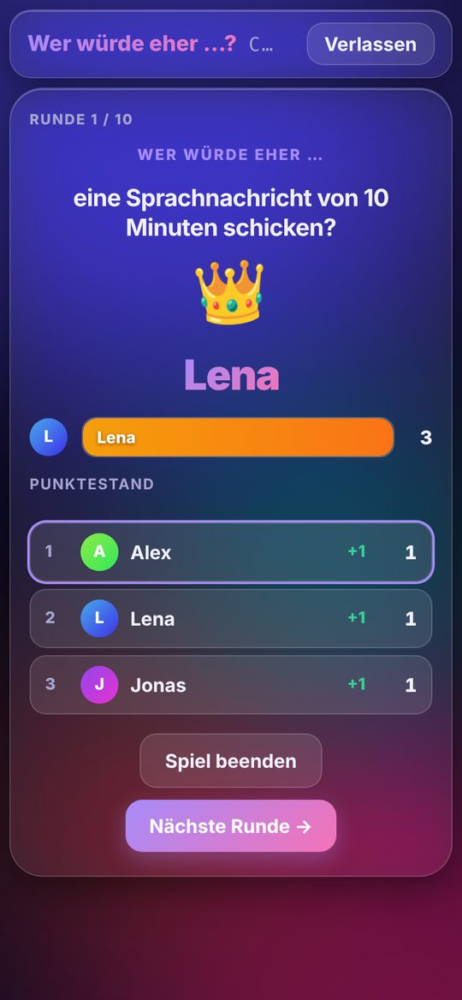 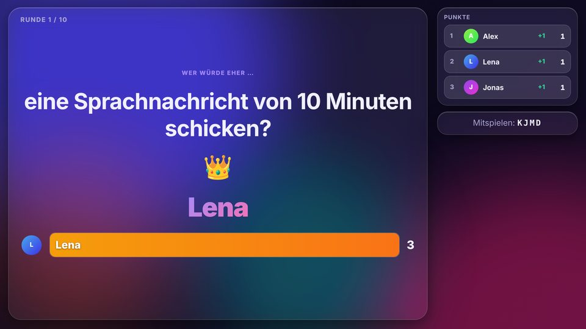

#### Lügenbaron
*3–12 Spieler · 15–25 Min. · 📺*

Ein wahrer, verrückter Fakt mit Lücke. Alle erfinden eine glaubwürdige Lüge, dann muss jeder die Wahrheit finden. Punkte gibt es für Treffer und fürs Reinlegen.

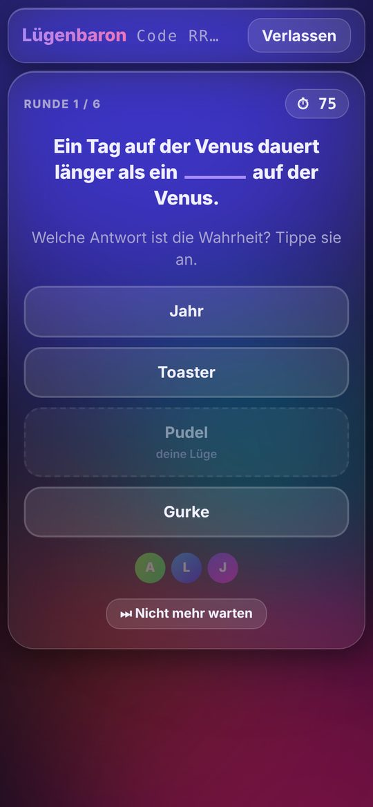  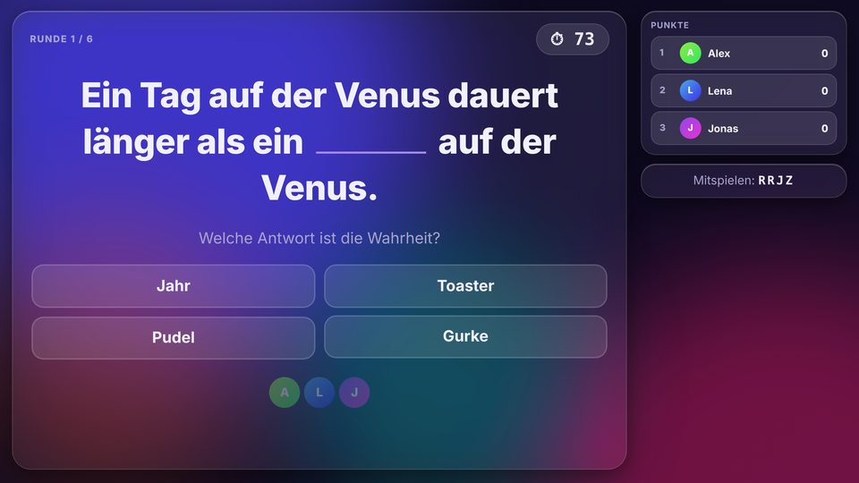

#### Punchline
*3–12 Spieler · 15–25 Min. · 📺*

Alle ergänzen denselben Satz so lustig wie möglich – danach wird anonym die beste Pointe gewählt.

 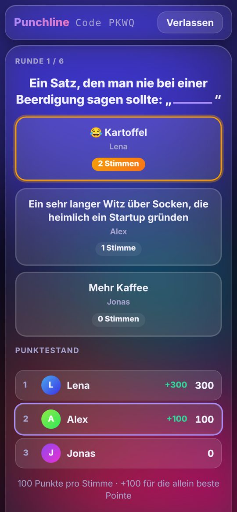 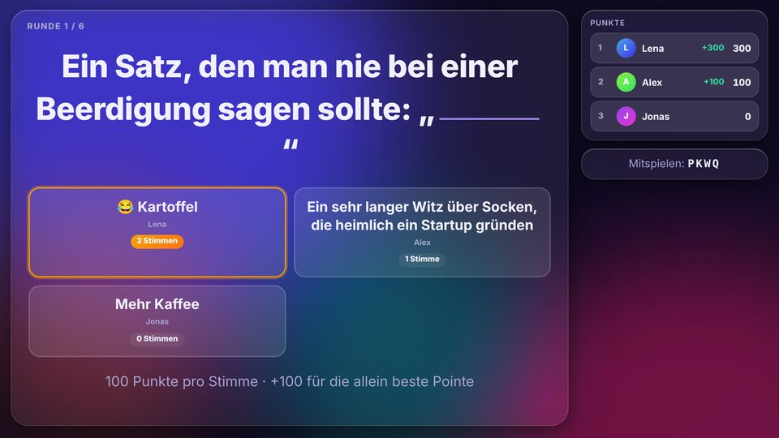

#### Imposter
*3–16 Spieler · ca. 5 Min. pro Runde*

Alle kennen das geheime Wort – nur einer nicht. Reihum ein Hinweiswort, dann abstimmen.

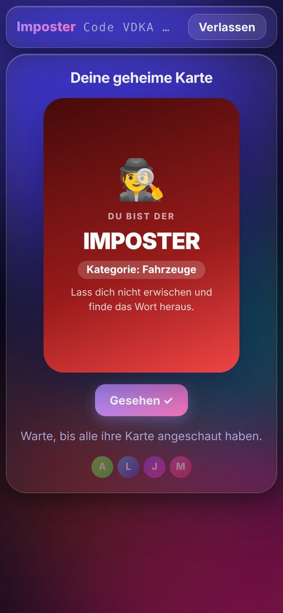

### Trinkspiele 🍻

> Trinkspiele sind ab 18. Alles klappt genauso mit Wasser, Saft oder Limo – trinkt verantwortungsvoll, niemand muss.

#### Ich hab noch nie …
*2–16 Spieler · 10–20 Min. · 📺*

Ein Satz, alle antworten geheim – wer es schon gemacht hat, trinkt. Wahlweise mit frecheren Sätzen.

 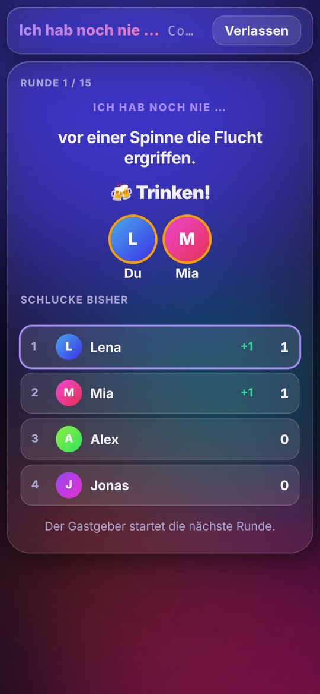 

#### Wahrheit oder Trinken
*2–16 Spieler · 15–30 Min. · 📺*

Reihum bekommt jemand eine Frage: ehrlich antworten – oder trinken.

 

#### Trinklotto
*2–16 Spieler · ca. 10 Min. · 📺*

Jeder bekommt geheim eine Farbe, eine Zahl und ein Tier. „Alle mit gerader Zahl trinken 3!“ – das Handy zeigt sofort, wen es trifft.

 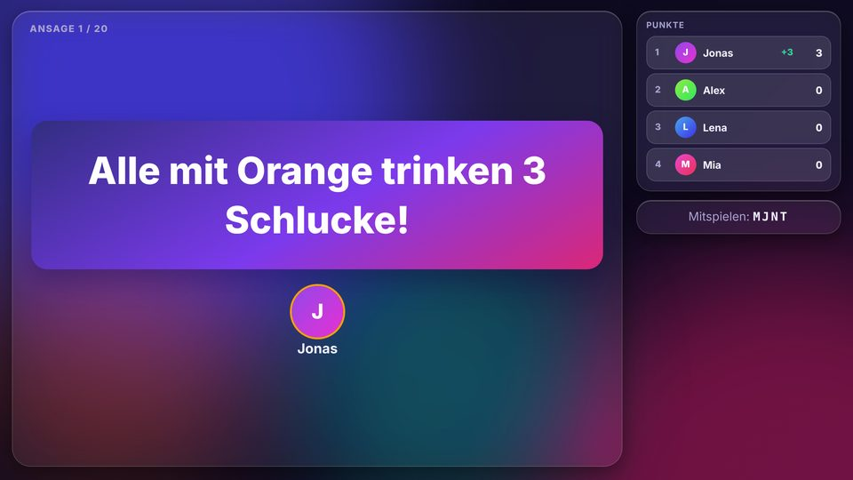

#### Pyramide
*2–9 Spieler · 10–15 Min. · 📺*

Vier Karten auf der Hand, die Pyramide wird Karte für Karte aufgedeckt: Wer den gleichen Wert hat, trinkt oder verteilt – oben mehr als unten.

#### Pferderennen
*2–16 Spieler · ca. 5 Min. pro Rennen · 📺*

Schlucke auf ein Ass setzen, die Karten treiben die Pferde an. Verlierer trinken, Sieger verteilen das Doppelte.

 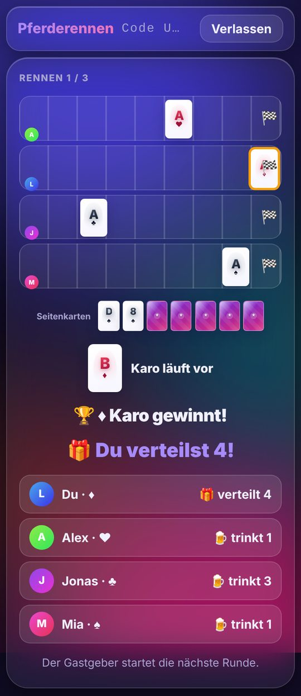 

#### Ring of Fire
*2–16 Spieler · 20–30 Min. · 📺*

Reihum eine Karte ziehen – jede hat eine Regel. Wer den vierten König zieht, leert den Becher.

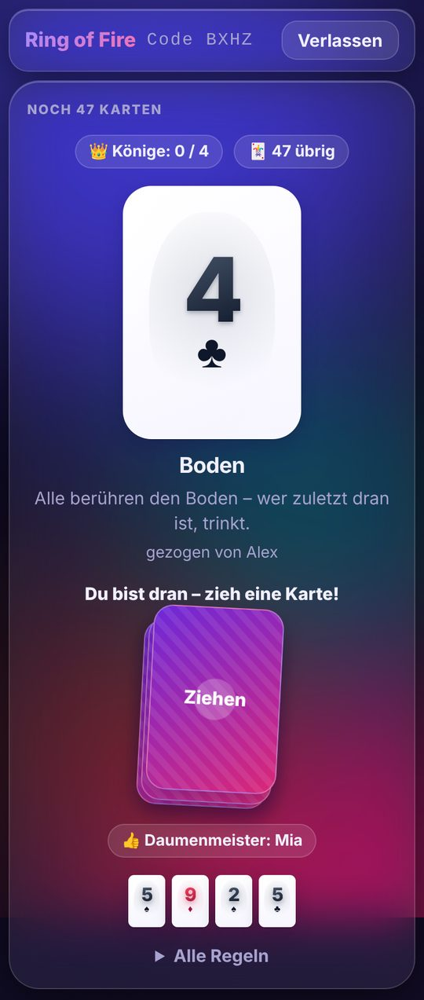 

## Mehr

📺 = mit Fernseher-Modus. Details, Regeln und Optionen stehen in [`spieleabend/DOCS.md`](spieleabend/DOCS.md).
Wie man den Spieleabend über eine eigene Domain erreichbar macht (Cloudflare-Tunnel), steht ebenfalls dort.
